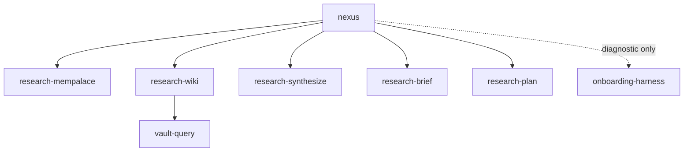

# nexus — Atomic Skills for Institutional Memory

`nexus` is an eleven-skill system that gathers institutional context before
implementation and captures approved, durable knowledge in an Obsidian wiki.
It combines MemPalace with a wiki-backed research flow.

## Skills

| Skill | Purpose |
| --- | --- |
| `nexus` | Orchestrate research and the final plan |
| `onboarding-harness` | Optional diagnostic for MCP / vault binding |
| `research-mempalace` | Extract MemPalace findings |
| `research-wiki` | Extract wiki findings through `vault-query` |
| `research-synthesize` | Merge findings and expose material conflicts |
| `research-brief` | Produce internal plan context |
| `research-plan` | Emit one requester-localized plan |
| `vault-query` | Perform focused wiki research |
| `vault-write` | Curate approved typed wiki pages |
| `vault-index` | Maintain indexes and the log |
| `vault-lint` | Report wiki health issues |

## Research Flow



Session start assumes MCP is available and defaults to `mcp-mode=repo-bound`.
No mandatory availability ping. Manifest lookup runs only when project/rooms are
ambiguous. Medium/full Phase 2a uses parallel Task agents (`nexus-mempalace` +
`nexus-wiki`, fallback `generalPurpose`). Phase 3 uses Task `explore`. Light
runs one research track inline on the parent.
`research-plan` emits the only final user-facing response — plain language in the
requester's locale, without file paths, source citations, or shell commands.
Instruction prose and inter-skill handoffs remain English with full technical
detail. Light requests receive 3–5 concise lines. Medium and full requests
receive Context, 3–7 steps, and verification — all human-readable.
## Wiki Capture

```text
session work, pasted material, files, or URLs
                  │
                  ▼
          vault-write (draft + approval)
                  │
                  ▼
        wiki/<typed page> ──▶ vault-index
```

`vault-write` is the only capture path. It drafts typed Entity, Concept,
Decision, Task, or Topic pages, records evidence, and writes only after the
requester approves. New wiki content must pass Wiki Purity: do not add
external-staging links, source queues, or lifecycle markers. Existing
historical artifacts remain lint-only `[LEGACY]` findings.

Wikilinks are wiki-semantic (`[[projects/<p>/Entities/<name>]]`); in
repo-bound mode MCP file paths start with `wiki/`.

## Install

```bash
# Inspect the eleven discoverable skills
npx skills add /Users/quetan/Development/nexus --list

# Install globally for Claude Code
npx skills add /Users/quetan/Development/nexus -g -a claude-code -y

# Install globally for Cursor
npx skills add /Users/quetan/Development/nexus -g -a cursor -y

# Optional: mirror Phase 2a Task agents for all projects
mkdir -p ~/.cursor/agents
cp /Users/quetan/Development/nexus/.cursor/agents/nexus-*.md ~/.cursor/agents/
```

## Usage

```text
/nexus "What does the project record say about favorite-dirs?"
"Save these approved session results"     # vault-write
"Ask the wiki about the API"              # vault-query
"Check wiki health"                       # vault-lint
```

## Requirements

- A `mempalace` MCP server for MemPalace research.
- An `mcpvault` MCP server for wiki operations.
- An Obsidian vault whose semantic content root is `wiki/`, for example
  `~/Development/obsidian-vault/wiki/`.

See the [design specification](docs/superpowers/specs/2026-08-19-nexus-atomic-skills-design.md)
and [agent contract](AGENTS.md) for the full architecture.
