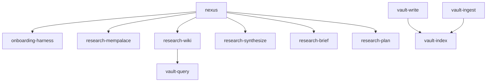

# nexus — Atomic Agent Skills for Institutional Memory

A modular system of atomic agent skills that enforce **institutional memory before implementation**. Built on MemPalace + Obsidian LLM Wiki.

## Skills

| Skill | Purpose | Lines |
|-------|---------|-------|
| `nexus` | Orchestrator — coordinates research flow | ~180 |
| `research-mempalace` | Extract context from MemPalace | ~60 |
| `research-wiki` | Extract context from Obsidian wiki | ~60 |
| `research-synthesize` | Merge sources, conflict resolution | ~60 |
| `research-brief` | Generate Russian Research Brief | ~80 |
| `research-plan` | Generate Implementation Plan | ~70 |
| `vault-write` | Evidence-gated raw capture → sources/ | ~90 |
| `vault-ingest` | Source → wiki pages | ~80 |
| `vault-query` | Medium vault research | ~70 |
| `vault-lint` | Wiki health check | ~80 |
| `vault-index` | Index/log/00_Index maintenance | ~60 |
| `onboarding-harness` | MCP + manifest checks | ~50 |

## Install

```bash
# Discover all skills
npx skills add ~/nexus --list

# Install globally for Claude Code
npx skills add ~/nexus -g -a claude-code -y

# Install for Cursor
npx skills add ~/nexus -g -a cursor -y
```

## Usage

```bash
# Full research workflow
/nexus "что там с favorite-dirs?"

# Direct vault operations
"сохрани результаты сессии"  # → vault-write
"спроси вики про API"        # → vault-query
"проверь здоровье вики"      # → vault-lint
"разложи source по полкам"   # → vault-ingest
```

## Architecture



## Requirements

- `mempalace` MCP server (for palace queries)
- `seekstone` MCP server (for wiki operations)
- Obsidian vault with LLM Wiki structure

## Origin

Refactored from `surgut-research` + `obsidian-task-note` into a generic,
project-agnostic atomic skill system. See `docs/superpowers/specs/` for design.
