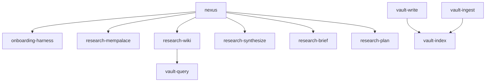

# nexus — Atomic Agent Skills for Institutional Memory

A modular system of atomic agent skills that enforce **institutional memory before implementation**. Built on MemPalace + Obsidian LLM Wiki.

## Skills

| Skill | Purpose | Lines |
|-------|---------|-------|
| `nexus` | Orchestrator — coordinates research flow | ~180 |
| `research-mempalace` | Extract context from MemPalace | ~60 |
| `research-wiki` | Extract context from Obsidian wiki | ~60 |
| `research-synthesize` | Merge sources, conflict resolution | ~60 |
| `research-brief` | Generate Russian Research Brief | ~80 |
| `research-plan` | Generate Implementation Plan | ~70 |
| `vault-write` | Evidence-gated direct wiki capture (typed pages, no raw staging) | ~70 |
| `vault-ingest` | Manual raw/ → wiki pages | ~70 |
| `vault-query` | Medium vault research | ~70 |
| `vault-lint` | Wiki health check | ~80 |
| `vault-index` | Index/log/00_Index maintenance, Raw Sources lifecycle | ~80 |
| `onboarding-harness` | MCP + manifest checks | ~50 |

## How the vault flow works

```
session work ──vault-write──▶ wiki/<typed page>        (direct, no raw/)
manual drop ──▶ raw/DD.MM.YYYY/<p>/<slug>.md
                     │
                     └─vault-ingest──▶ wiki/<typed page>   (manual/legacy flow)
```

- **vault-write** always writes directly into `wiki/`. Never stages in `raw/`.
- **vault-ingest** consumes only manual/external `raw/` files. Once ingested,
  the `⏳ pending` line in `00_Index.md` is removed and replaced with
  ✅ links to the resulting typed wiki pages.
- **Wiki pages never link to `raw/`.** `raw/` is staging only.
- All wikilinks are **vault-root-relative** — `[[projects/<p>/<Bucket>/<name>]]`,
  never `[[wiki/...]]`. `wiki/` is the vault root.

## Install

```bash
# Discover all skills
npx skills add ~/nexus --list

# Install globally for Claude Code
npx skills add ~/nexus -g -a claude-code -y

# Install for Cursor
npx skills add ~/nexus -g -a cursor -y
```

## Usage

```bash
# Full research workflow
/nexus "что там с favorite-dirs?"

# Direct vault operations
"сохрани результаты сессии"  # → vault-write
"спроси вики про API"        # → vault-query
"проверь здоровье вики"      # → vault-lint
"разложи source по полкам"   # → vault-ingest
```

## Architecture



## Requirements

- `mempalace` MCP server (for palace queries)
- `seekstone` MCP server bound to an Obsidian vault (for wiki operations)
- Obsidian vault with LLM Wiki structure (`wiki/` + `raw/` sibling, e.g.
  `~/Development/obsidian-vault/`)
- Vault root resolution: via seekstone probe; file I/O fallback reads
  `~/Development/obsidian-vault/wiki/`

## Origin

Refactored from `surgut-research` + `obsidian-task-note` into a generic,
project-agnostic atomic skill system. See `docs/superpowers/specs/` for design.

## Current patterns

- **Direct capture:** vault-write integrates into `wiki/` immediately — no
  `raw/` intermediary. Evidence tags (`user:`, `vault:`, `UNVERIFIED`) still
  required.
- **Typed pages:** Session capture produces entity / concept / decision / task
  / topic pages, not a monolithic "source" dump.
- **Ingest queue:** `00_Index.md Raw Sources` section lists `⏳ pending` raw
  files only; once consumed, line is replaced by wiki links under typed
  sections.
