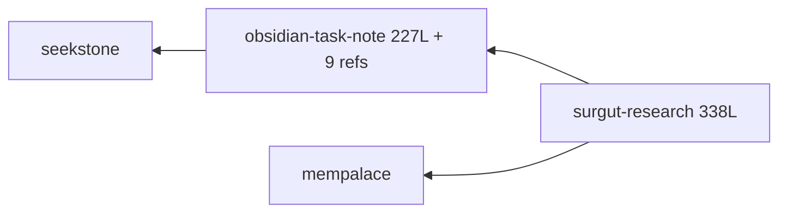
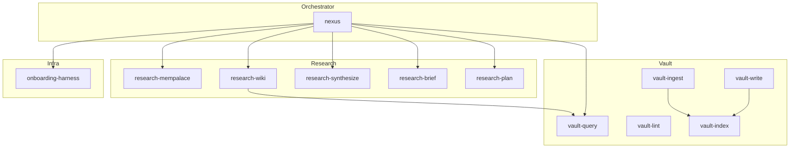

# Nexus: Atomic Agent Skills Design

## Problem

Two monolithic agent skills — `surgut-research` (338 lines) and `obsidian-task-note` (227 lines + 9 references) — are tightly coupled but live in separate locations. The workflow is surgut-specific, preventing reuse. Each skill activation loads the entire context, wasting tokens on irrelevant sections.

## Current Architecture



**Problems:**
- `surgut-research` hardcodes surgut monorepo paths, rooms, manifest
- `obsidian-task-note` is the only vault skill but contains 4+ distinct responsibilities
- No skill can be used standalone outside the surgut context
- Conflict resolution (newer-wins) lives in `surgut-research`, not in the vault layer
- Verification checklists duplicated across both skills

## Design: Atomic Decomposition

### Principles

1. **Single-purpose** — each skill does ONE thing, does it well
2. **Light coupling** — skills declare `requires-skill` in frontmatter; can be used standalone or chained
3. **Progressive disclosure** — frontmatter (~100 tokens) → SKILL.md (<5000 tokens) → references (JIT)
4. **Project-agnostic** — nexus derives project context from git/cwd/MemPalace manifest, not hardcoded
5. **Read/research vs write/ingest** — nexus is read-only; write/ingest delegated to vault-* skills

### Skill Map



### Skill Definitions

| # | Name | Source | Lines | Entry point in original |
|---|------|--------|-------|------------------------|
| 1 | `nexus` | surgut-research (orchestrator) | ~200 | Entire SKILL.md |
| 2 | `research-mempalace` | surgut-research Phase 2a-A | ~60 | "Phase 2a — MemPalace" + subagent prompts |
| 3 | `research-wiki` | surgut-research Phase 2a-B + obsidian-task-note query | ~80 | "Phase 2a — Wiki" + query protocol |
| 4 | `research-synthesize` | surgut-research Phase 2b | ~60 | "Phase 2b — Synthesize Vault" |
| 5 | `research-brief` | surgut-research Phase 4 | ~80 | "Phase 4 — Research Brief" + template |
| 6 | `research-plan` | surgut-research Phase 5 | ~80 | "Phase 5 — Implementation Plan" + template |
| 7 | `vault-write` | obsidian-task-note `write` | ~100 | "write — evidence-gated raw capture" |
| 8 | `vault-ingest` | obsidian-task-note `ingest` | ~100 | "ingest — source → wiki" |
| 9 | `vault-query` | obsidian-task-note `query` | ~80 | "query — medium vault research" |
| 10 | `vault-lint` | obsidian-task-note `lint` | ~80 | "lint — wiki health check" |
| 11 | `vault-index` | obsidian-task-note index/log protocol | ~60 | Split from write/ingest protocols |
| 12 | `onboarding-harness` | surgut-research Phase 0 | ~50 | "Phase 0 — Onboarding Harness" |

### Token Economy

| Scenario | Before | After | Savings |
|----------|--------|-------|---------|
| Simple query (vault only) | 565 lines (both skills) | ~80 lines (vault-query) | ~85% |
| Full research flow | 565 + 9 refs | ~450 lines across 6 skills JIT | ~40% |
| Health check (lint) | 565 lines | ~80 lines (vault-lint) | ~85% |
| Write session | 565 lines | ~100 lines (vault-write) | ~82% |

### Interaction Model

```
User: "что там с favorite-dirs?"
  → nexus activates
    → onboarding-harness (MCP check)
    → research-mempalace (palace search)
    → research-wiki → vault-query (wiki search)
    → research-synthesize (merge, newer-wins)
    → research-brief (Russian brief)

User: "сохрани результаты"
  → vault-write activates directly
    → evidence pass → draft → save → vault-index (log update)
```

### Migration

1. Create all 13 SKILL.md files in `~/nexus/skills/*/`
2. Create references/ for skills needing external protocols
3. Verify with `npx skills add ~/nexus --list`
4. Install globally: `npx skills add ~/nexus -g -a claude-code -y`
5. Update old .agents/ installs to point to new repo
6. Remove old `surgut-research` from `.agents/skills/`

### Risk & Mitigation

| Risk | Mitigation |
|------|------------|
| Split increases total token count across skills | JIT loading means only active skills are loaded, not all 13 |
| Sub-skill interaction failures | `requires-skill` in frontmatter enforces dependency graph |
| seekstone MCP changes | `vault-*` skills reference seekstone protocol in one place |
| User muscle memory for `/surgut-research` | `nexus` description includes "use when /surgut-research, surgut research" |
